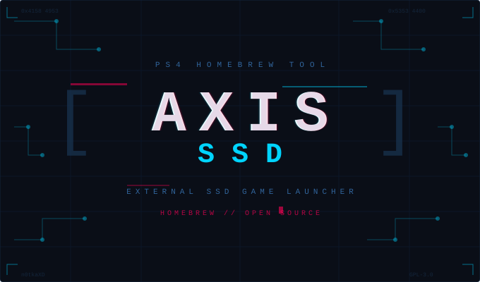

<p align="center">
  
</p>

<h3 align="center">
  Запуск игр с внешнего SSD на PS4 без копирования на внутренний диск<br/>
  <sub>Launch games from an external SSD on PS4 without copying to internal storage</sub>
</h3>

<p align="center">
  
  
  
  
</p>

---

## 🇷🇺 Русский

### Что это?

**AxisSSD** — утилита для PS4 (прошивка 12.00 + GoldHEN), которая позволяет регистрировать игры (fake PKG) с внешнего SSD в формате exFAT прямо в системном меню PS4 **без копирования на внутренний диск**. Вместо копирования файлов создаётся символическая ссылка на PKG на внешнем накопителе.

### Как это работает

1. Payload отправляется на PS4 через GoldHEN BinLoader (порт 9090)
2. PS4 сканирует папку `/mnt/usb0/PKG/` на внешнем SSD
3. Для каждого найденного PKG создаётся запись в `/user/app/<TITLE_ID>/`
4. `app.pkg` — символическая ссылка, указывающая на PKG на SSD
5. Вызывается `sceAppInstUtilAppInstallAll()`, который сканирует `/user/app/`, регистрирует новые тайтлы в `app.db` и обновляет главный экран
6. Игры появляются в меню PS4 и запускаются прямо с SSD

### Требования

- PS4 с прошивкой **12.00** (основной тест проводился на этой версии; совместимость с другими прошивками не проверена и требует тестирования)
- **GoldHEN 2.x** с включённым **BinLoader Server**
- Внешний SSD/HDD в формате **exFAT**, подключённый к PS4 по USB
- PKG-файлы в папке `/mnt/usb0/PKG/` на накопителе
- Mac (для запуска скрипта)

### Установка и запуск (macOS)

1. Скачайте `AxisSSD_mac.zip` из раздела [Releases](../../releases)
2. Распакуйте архив
3. Убедитесь, что PS4 включена, GoldHEN загружен, BinLoader активен, SSD подключён
4. Положите PKG-файлы в папку `PKG` на вашем SSD
5. Откройте `ps4_register.command` двойным кликом в Finder
6. При первом запуске введите IP-адрес PS4 (он сохранится в `ps4_ip.txt`)
7. Скрипт проверит доступность PS4 и содержимое папки PKG
8. После отправки payload подождите ~60 секунд — игры появятся в главном меню PS4
9. **Перезагрузите PS4** (и загрузите GoldHEN снова) — это необходимо для запуска игр. Без перезагрузки иконки видны, но при запуске будет ошибка CE-32930-7

### Структура проекта

```
├── ps4_register.command    # Скрипт запуска (macOS)
├── ps4_ip.txt              # IP-адрес PS4 (создаётся при первом запуске)
├── tools/
│   └── send_payload.py     # Отправка бинарного payload через BinLoader
├── proto/
│   ├── reg/                # Основной payload регистрации
│   │   ├── main.c          # Сканирование PKG + создание симлинков + AppInstallAll
│   │   ├── place.c / .h    # Создание структуры директорий title
│   │   └── bgft.c / .h     # Запись PDB-записей для BGFT
│   ├── bgft_probe/         # Исследовательские payload для BGFT API
│   ├── build/              # Скомпилированные payload (.bin)
│   └── refs/
│       └── ShadowMountPlus/  # Референсный проект
├── ps4mount/               # Референс: ps4mount (PS5 daemon)
└── ps4-pkg2usb/            # Референс: PKG2USB
```

---

## 🇬🇧 English

### What is this?

**AxisSSD** is a PS4 utility (firmware 12.00 + GoldHEN) that registers fake PKG games from an external exFAT SSD directly into the PS4 system menu **without copying them to internal storage**. Instead of copying files, it creates a symbolic link pointing to the PKG on the external drive.

### How it works

1. A payload is sent to PS4 via GoldHEN BinLoader (port 9090)
2. PS4 scans the `/mnt/usb0/PKG/` folder on the external SSD
3. For each found PKG, an entry is created in `/user/app/<TITLE_ID>/`
4. `app.pkg` is a symbolic link pointing to the PKG on the SSD
5. `sceAppInstUtilAppInstallAll()` is called — it scans `/user/app/`, registers new titles in `app.db`, and refreshes the home screen
6. Games appear in the PS4 menu and launch directly from the SSD

### Requirements

- PS4 with firmware **12.00** (primary testing was done on this version; compatibility with other firmwares is untested and needs verification)
- **GoldHEN 2.x** with **BinLoader Server** enabled
- External SSD/HDD formatted as **exFAT**, connected to PS4 via USB
- PKG files in the `/mnt/usb0/PKG/` folder on the drive
- Mac (to run the script)

### Installation & usage (macOS)

1. Download `AxisSSD_mac.zip` from [Releases](../../releases)
2. Extract the archive
3. Make sure PS4 is on, GoldHEN is loaded, BinLoader is active, SSD is connected
4. Place your PKG files in the `PKG` folder on your SSD
5. Double-click `ps4_register.command` in Finder
6. On first run, enter your PS4's IP address (it will be saved to `ps4_ip.txt`)
7. The script will check PS4 availability and PKG folder contents
8. After the payload is sent, wait ~60 seconds — games will appear in the PS4 main menu
9. **Reboot PS4** (and load GoldHEN again) — this is required to launch games. Without a reboot, icons are visible but launching will show error CE-32930-7

### Project structure

```
├── ps4_register.command    # Launch script (macOS)
├── ps4_ip.txt              # PS4 IP address (created on first run)
├── tools/
│   └── send_payload.py     # Binary payload sender via BinLoader
├── proto/
│   ├── reg/                # Main registration payload
│   │   ├── main.c          # PKG scan + symlink creation + AppInstallAll
│   │   ├── place.c / .h    # Title directory structure creation
│   │   └── bgft.c / .h     # PDB record writer for BGFT
│   ├── bgft_probe/         # Research payloads for BGFT API
│   ├── build/              # Compiled payloads (.bin)
│   └── refs/
│       └── ShadowMountPlus/  # Reference project
├── ps4mount/               # Reference: ps4mount (PS5 daemon)
└── ps4-pkg2usb/            # Reference: PKG2USB
```

---

## Technical details

### Registration flow

The core payload (`proto/reg/main.c`) performs the following:

1. **Jailbreak escalation** — elevates process privileges via GoldHEN kernel APIs
2. **USB PKG scan** — enumerates `/mnt/usb0/PKG/*.pkg` on the external drive
3. **Title directory creation** — for each PKG, creates `/user/app/<TITLE_ID>/` with:
   - `app.pkg` → symlink to the PKG on USB (`/mnt/usb0/PKG/<file>.pkg`)
   - `sce_sys/param.sfo` — extracted from the PKG header
   - `sce_sys/icon0.png` — extracted from the PKG
4. **BGFT PDB records** — writes `d0.pdb`/`d1.pdb` task records for the Background File Transfer daemon (required for game-category titles to launch)
5. **ShellCore refresh** — calls `sceAppInstUtilAppInstallAll(NULL)` which scans `/user/app/`, registers new titles in `app.db`, and refreshes the home screen UI (~58 seconds on FW 12.00)

### Known limitations

- **Reboot required for game-category titles** — games (`gd` category) require a BGFT task in daemon memory to launch. While PDB files are written and `RegisterTaskByStorageEx` can register tasks at runtime, the BGFT daemon needs a full reboot to properly initialize the launch context. Apps (`ac` category) work without reboot.
- **First registration takes ~60 seconds** — `sceAppInstUtilAppInstallAll` performs a full scan of `/user/app/`
- **exFAT only** — the external drive must be formatted as exFAT (not ext4 or NTFS)

---

## Credits & references

This project builds on the work of the PS4 homebrew community:

| Project | Author | Description |
|---------|--------|-------------|
| [ps4mount](https://github.com/gasb07/ps4mount) | **gasb07** | PS5 daemon for mounting PS4 game images — reference for mount/symlink approach |
| [ShadowMountPlus](https://github.com/) | — | PS4 shadow mount utility — reference for game lifecycle and kevent tracking |
| [ps4-pkg2usb](https://github.com/SiSTRo/ps4-pkg2usb) | **SiSTRo** | PKG to USB conversion tool — reference for PKG structure and param.sfo extraction |
| [GoldHEN](https://github.com/GoldHEN) | **SiSTRo & team** | PS4 homebrew enabler — provides kernel APIs, BinLoader, and FTP server |
| [ps4-payload-sdk](https://github.com/Scene-Collective/ps4-payload-sdk) | **Scene Collective** | SDK for building PS4 payloads — build toolchain used by this project |
| [GoldHEN Plugins SDK](https://github.com/GoldHEN/GoldHEN_Plugins_SDK) | **GoldHEN team** | Plugin development SDK for GoldHEN |

### Research

- BGFT (Background File Transfer) daemon internals — enumerated 15/39 API functions available on FW 12.00
- `sceAppInstUtilAppInstallAll` discovery — found that this single call handles app.db registration AND home screen refresh
- PDB task record format — reverse-engineered from existing BGFT task files

---

## License

This project is licensed under the **GNU General Public License v3.0** — see [LICENSE](LICENSE) for details.

All referenced projects (ps4mount, ShadowMountPlus, ps4-pkg2usb, GoldHEN SDK) are also GPL-3.0 licensed.

---

<p align="center">
  <b>AxisSSD</b> by <a href="https://github.com/n0tkaXD">n0tkaXD</a><br/>
  <sub>Made with reverse engineering, kernel logs, and a lot of patience</sub>
</p>
